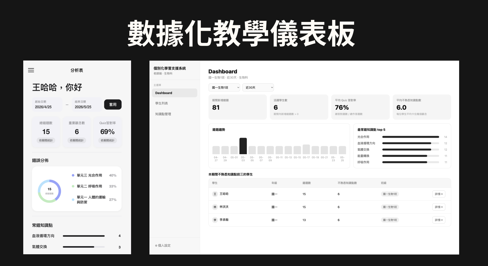

# AI Mistake Learning Assistant Platform

[**English**](./README.md) | [繁體中文](./README.zh-TW.md)

**AI-Powered Personalized Learning & Teaching Analytics Platform**

**React · Node.js · Express · SQLite · Gemini API · REST API**

An AI-assisted learning platform designed to help tutoring centers identify recurring student mistakes, track knowledge gaps, and support data-driven teaching decisions.

Developed by a five-member academic team following **three rounds of interviews with a real tutoring center**, the project translates practical educational needs into an integrated student–teacher information system.

---

## 1. Project Overview

### The Problem

In traditional tutoring environments, students often make repeated mistakes related to the same concepts, while teachers lack efficient tools to systematically identify and monitor these learning difficulties.

Individual mistake records provide limited insight into long-term learning patterns, making it difficult to identify recurring knowledge gaps and provide targeted learning support.

### Our Solution

The Mistake Learning System connects student mistake tracking with AI-assisted analysis and teaching dashboards.

The platform helps:

- **Students** record mistakes, identify weak concepts, and practice with AI-generated questions.
- **Teachers** monitor learning patterns, identify frequently missed concepts, and support personalized instruction.

The goal is to move beyond isolated mistake records toward structured, data-informed learning support.

---

## 2. Development Process & System Integration

The platform was developed through a collaborative process involving user research, requirement analysis, system architecture design, AI integration, and application testing.

### Requirement Analysis & Project Coordination

- Conducted three rounds of interviews with a tutoring center to understand student and teacher pain points.
- Translated user requirements into system features and development priorities.
- Coordinated development activities across the five-member team.

### System Architecture & API Design

- Designed RESTful API specifications connecting the React frontend, Express backend, and SQLite database.
- Established shared JSON response formats, ISO 8601 timestamp conventions, and error-handling standards.
- Integrated frontend and backend modules through consistent API communication.

### AI Integration & Workflow Design

- Integrated the Gemini API to support AI-assisted concept analysis and question generation.
- Implemented **Mock and Real AI modes** for development, testing, and cost-efficient validation.
- Connected AI processing workflows with student learning records and application services.

### Database & Application Integration

- Developed backend integration logic supporting SQLite data operations.
- Established database initialization and seed workflows.
- Configured shared backend services to support student and teacher interfaces.

---

## 3. Key Features

### Product Preview

#### Interface



### Student Learning Interface

- Upload and record incorrectly answered questions.
- AI-assisted knowledge-point classification.
- Organized mistake history and learning records.
- AI-generated practice questions targeting weak concepts.

### Teacher Dashboard

- View class-level mistake summaries and learning trends.
- Identify frequently missed or high-risk knowledge points.
- Analyze learning patterns across 7-day, 30-day, or supported custom periods.
- Access student-level learning insights to support instructional planning.

---

## 4. System Architecture

```text
              Student Interface
                   (React)
                      |
                      v
                Express API
                      |
          +-----------+-----------+
          |                       |
          v                       v
     SQLite Database         AI Service Layer
          |                       |
          |                 Mock / Gemini API
          |                       |
          +-----------+-----------+
                      |
                      v
              Learning Analytics
                      |
                      v
              Teacher Dashboard
```

The platform integrates learning records, AI-assisted processing, and teaching analytics through shared backend services.

### AI Execution Modes

| Mode | Description | API Key |
|---|---|---|
| **Mock Mode** | Uses simulated AI responses for development and demonstration | Not required |
| **Real AI Mode** | Uses Gemini API for AI-assisted processing | Required |

Mock Mode allows the system to be demonstrated without external API credentials or usage costs.

This separation also supports integration testing and validation of application workflows independently of external AI services.

---

## 5. Technology Stack

| Layer | Technology |
|---|---|
| Frontend | React |
| Backend | Node.js, Express |
| Database | SQLite |
| AI Integration | Google Gemini API |
| Communication | RESTful API, JSON |
| Development | npm, Database Seed Scripts |
| Testing & Demonstration | Mock / Real AI Modes |

---

## 6. Getting Started

**Requirements:** Node.js 18+ and npm.

The documented commands target a Unix-like environment.

### Installation

```bash
npm --prefix backend install
npm --prefix frontend/studentMobile install

npm run db:init
npm run db:seed
npm run build:student
```

### Option A — Mock Mode (Recommended)

Launch the system without an API key:

```bash
npm run start:mock
```

### Option B — Real AI Mode

Set a Gemini API key in the local environment:

```bash
export GEMINI_API_KEY="YOUR_API_KEY"
npm run start:real
```

Never commit API credentials to the repository.

### Local Access

| Interface | URL |
|---|---|
| Student Interface | `http://localhost:3001/student/` |
| Teacher Dashboard | `http://localhost:3001/teacher/` |

*The commands above reflect the project's documented setup and should be verified against the current repository scripts and directory structure.*

---

## 7. API Design & Documentation

The backend exposes RESTful APIs supporting mistake analysis, learning sessions, AI-generated exercises, and dashboard analytics.

### Selected Endpoints

| Method | Endpoint | Purpose |
|---|---|---|
| POST | `/api/ai/concept-classification` | Classify question concepts |
| POST | `/api/chat-sessions` | Create learning chat sessions |
| POST | `/api/exams/generate` | Generate personalized practice questions |
| GET | `/api/dashboard/summary` | Retrieve class-level learning summaries |

The API specification documents request and response structures, shared data conventions, and error-handling requirements.

**[View API Documentation](./API_DOCS.md)**

---

## 8. Project Outcomes & Learnings

The project produced an integrated student–teacher application prototype combining AI-assisted learning support, structured data management, and teaching analytics.

### Project Outcomes

- Developed a functional prototype connecting student and teacher interfaces.
- Integrated learning records, AI-assisted concept analysis, and personalized question-generation workflows.
- Established shared backend services and consistent API communication.
- Implemented Mock and Real AI execution modes for development and demonstration.
- Completed an operational demonstration of the integrated system.

### Key Learnings

- Translating stakeholder interviews into functional system requirements.
- Designing consistent APIs for collaborative software development.
- Integrating AI services into an end-to-end application workflow.
- Coordinating development across a five-member team.
- Separating application testing from external AI service dependencies through Mock Mode.

### Project Scope & Limitations

The platform was developed as an academic prototype informed by real user interviews.

Large-scale deployment, measurable learning improvements, and production reliability have not been established.

Future development may focus on user testing, improved AI analysis accuracy, system scalability, and learning-outcome evaluation.

---

## 9. Project Information

**Project:** Mistake Learning System — AI-Powered Personalized Learning Platform

**Project Type:** Academic Team Project

**Team:** Five-member development team

**Development Approach:** User Research · Requirement Analysis · System Design · AI Integration · Application Testing

**Focus Areas:** Educational Technology · AI Application Development · System Integration · Learning Analytics

**Status:** Functional Academic Prototype

---

*This repository documents a collaborative academic software development project. The system was designed and implemented through team-based research, development, and integration.*
