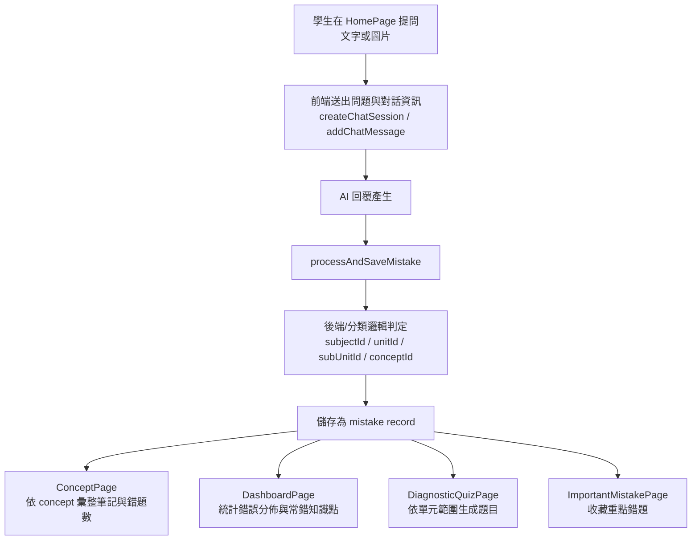

# Mistake Learning System - Frontend

這是一個以 **React** 開發的學習系統前端，主題是「用錯題幫助學習」。
系統將學生提問、對話紀錄、錯題收藏、重點觀念、即時測驗、學習分析整合在同一個 App 中。

---

## 目錄

- [專案定位](#專案定位)
- [技術棧](#技術棧)
- [前端功能總覽](#前端功能總覽)
- [各頁面功能說明](#各頁面功能說明)
- [資料流與狀態管理](#資料流與狀態管理)
- [API 介接說明](#api-介接說明)
- [專案結構](#專案結構)
- [安裝與執行](#安裝與執行)
- [開發備註與已知限制](#開發備註與已知限制)
- [可優化方向](#可優化方向)

---

## 專案定位

本前端主要解決以下需求：

1. 學生可以快速提問（文字 / 圖片）並取得系統回覆。
2. 問答內容可沉澱為「錯題」與「概念筆記」。
3. 透過收藏機制，建立個人化重點複習清單。
4. 透過即時測驗與分析表，觀察弱點與學習進度。

---

## 技術棧

- **React 19**
- **React Router DOM 6**（多頁路由）
- **Create React App / react-scripts 5**
- **Context API**（`FavoritesContext`）
- **Fetch API**（呼叫後端 REST API）
- CSS Modules 風格拆分（`src/style/*.css` 與 `global.css`）

---

## 前端功能總覽

### 1) 學習對話（Home）
- 支援文字輸入與圖片上傳（檔案型別與大小驗證）
- 顯示對話泡泡、時間戳、AI 回覆 loading 效果
- 送出後建立 chat session，並儲存使用者/AI 訊息
- 將問答內容轉為錯題資料（供後續錯題本與分析使用）

### 2) 錯題管理
- 依單元/子單元瀏覽錯題
- 錯題可切換收藏（星號）
- 可集中檢視「重要錯題」

### 3) 概念筆記管理
- 顯示概念筆記並補齊單元資訊、錯題關聯數
- 筆記可切換收藏
- 可集中檢視「重要觀念」

### 4) 即時測驗
- 可設定科目、範圍、題數、難度
- 題目由錯題資料生成，不足時自動補預設題
- 支援作答回饋、成績頁、解析檢視
- 可把測驗題加入錯題本

### 5) 學習分析 Dashboard
- 統計總錯題、概念數、答對率
- 錯誤分佈（圓環圖）
- 常錯知識點（排序與長條視覺）
- 可設定日期區間重算統計

### 6) 對話歷史
- 依日期分組顯示歷史對話
- 點擊展開可看當次對話訊息
- 支援刪除對話 session

### 7) 個人設定
- 顯示姓名、年級、電話、科目、Email
- 通知開關 UI（前端狀態）

---

## AI 知識點分類流程圖



---

## 各頁面功能說明

> 路由定義見 `src/App.js`

| 路由 | 檔案 | 功能重點 |
|---|---|---|
| `/` | `pages/HomePage.js` | 問答主頁：提問、上傳圖片、訊息儲存、轉錯題 |
| `/menu` | `pages/MenuPage.js` | 功能入口頁：我的最愛、學習工具導覽 |
| `/chapters` | `pages/ChapterListPage.js` | 章節/子章節展開，導向子章錯題頁 |
| `/mistake/:chapterId` | `pages/MistakeDetailPage.js` | 依 `subUnitId` 顯示錯題清單與收藏切換 |
| `/important-mistake` | `pages/ImportantMistakePage.js` | 僅顯示已收藏錯題 |
| `/concept` | `pages/ConceptPage.js` | 顯示概念筆記，整合單元資訊與錯題數 |
| `/important-concept` | `pages/ImportantConceptPage.js` | 僅顯示已收藏概念筆記 |
| `/diagnostic-quiz` | `pages/DiagnosticQuizPage.js` | 測驗設定、作答、結果、加入錯題本 |
| `/dashboard` | `pages/DashboardPage.js` | 日期篩選、錯誤分佈、常錯知識點 |
| `/chat-history` | `pages/ChatHistoryPage.js` | 對話紀錄列表、展開訊息、刪除 session |
| `/account` | `pages/AccountPage.js` | 個人資料顯示與通知 UI |

---

## 資料流與狀態管理

## 1. 全域狀態：`FavoritesContext`

檔案：`src/data/FavoritesContext.js`

- 管理 `favoriteMistakes`、`favoriteNotes`、`loading`
- 封裝：
  - `loadFavoritedMistakes()`
  - `loadFavoritedNotes()`
  - `toggleMistakeFavorite()`
  - `toggleNoteFavorite()`

## 2. API Service Layer

檔案：`src/services/api.js`

- 統一 `request()` 包裝 fetch、錯誤處理
- 依功能分區提供 API 函式：
  - 基礎資料
  - 錯題
  - 概念筆記
  - 最愛
  - 對話
  - 分析
  - 學生資料
  - 測驗題生成

## 3. 頁面層狀態

- 每頁使用 `useState + useEffect` 管理資料載入
- 以「進頁載入、操作後重載」為主（例如收藏切換後重新拉資料）

---

## API 介接說明

前端預設 API Base URL：

```txt
http://localhost:3001/api
```

目前主要使用到的端點類型：

- `GET /subjects`, `GET /subjects/:id/units`, `GET /units/:id/subunits`
- `GET /students/:id/mistakes`, `POST /mistakes`, `PATCH /mistakes/:id/star`
- `GET /students/:id/concept-notes`, `PATCH /concept-notes/:id/star`
- `GET /students/:id/chat-sessions`, `GET /chat-sessions/:id/messages`
- `POST /chat-sessions`, `POST /chat-sessions/:id/messages`, `DELETE /chat-sessions/:id`
- `GET /students/:id/analytics/summary`, `GET /students/:id/analytics/charts`

> 備註：`api.js` 目前固定 `CURRENT_STUDENT_ID = student_001`。

---

## 專案結構

```bash
src/
├── App.js
├── components/
│   ├── ConceptList.js
│   ├── MistakeList.js
│   ├── StarButton.js
│   ├── PageHeader.js
│   └── ...
├── data/
│   ├── FavoritesContext.js
│   ├── subUnitMapping.js
│   ├── quizData.js
│   └── ...
├── pages/
│   ├── HomePage.js
│   ├── ChapterListPage.js
│   ├── MistakeDetailPage.js
│   ├── ConceptPage.js
│   ├── DiagnosticQuizPage.js
│   ├── DashboardPage.js
│   └── ...
├── services/
│   └── api.js
├── style/
│   └── *.css
├── utils/
│   └── timeUtils.js
└── global.css
```

---

## 安裝與執行

### 1) 安裝

```bash
npm install
```

### 2) 啟動開發環境

```bash
npm start
```

前端預設網址：`http://localhost:3000`

### 3) 建置

```bash
npm run build
```

### 4) 測試

```bash
npm test
```

---

## 開發備註與已知限制

1. **後端依賴**：本專案需要 `localhost:3001` 後端服務，未啟動時多數頁面會無法取得資料。
2. **學生 ID 固定**：目前以前端常數 `student_001` 模擬登入態。
3. **部分 fallback 邏輯**：例如測驗題不足時會補預設題。
4. **資料來源混用**：HomePage 仍可見 localStorage 與 API 混合邏輯，未來建議整併。
5. **AccountPage**：目前直接 fetch `students/student_001`，尚未統一透過 service layer。

---

## 可優化方向

- [ ] 導入登入與權限（JWT / Session）
- [ ] API Base URL 改為 `.env`
- [ ] 完整錯誤提示與重試機制
- [ ] 將資料請求改為 React Query/SWR（改善快取與同步）
- [ ] 單元測試 + E2E 測試（例如 Playwright）
- [ ] 無障礙與 RWD 細節優化

---

## Scripts

- `npm start` - 開發模式
- `npm test` - 執行測試
- `npm run build` - 產生 production build
- `npm run eject` - 彈出 CRA 設定（不可逆）

---

## License

目前尚未附上授權，若要公開到 GitHub，建議新增 `LICENSE`（常見：MIT）。
