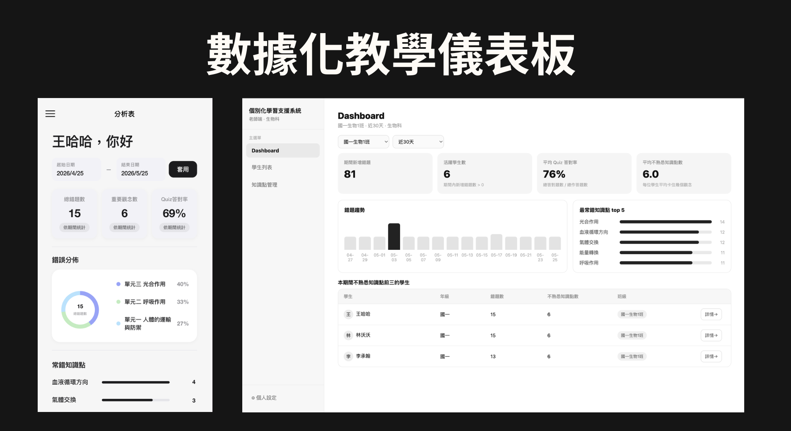

# AI MISTAKE LEARNING ASSISTANT PLATFORM ｜補習班個別化學習AI支援系統

[English](./README.md) | [**繁體中文**](./README.zh-TW.md)

**AI 個人化學習 · 教學數據分析 · 系統整合 · 產品設計**

**React · Node.js · Express · SQLite · Gemini API · REST API**

本專案為五人團隊開發的 AI 輔助學習平台，透過對實際補習班進行 **3 輪需求訪談**，了解學生錯題追蹤及教師個別化教學的困難，並將訪談結果轉換為可操作的資訊系統。

系統整合學生錯題紀錄、AI 知識點分析、個人化練習題生成及教師端學習分析 Dashboard，協助補習班從單一錯題紀錄走向系統化的學習追蹤與教學決策。

## 一、專案背景與問題

傳統補習班的錯題管理多仰賴學生自行整理或教師人工觀察。

然而，學生可能反覆在相同知識點犯錯，教師卻難以有效掌握：

- 學生長期的知識弱點
- 班級常見錯誤概念
- 個別學生需要加強的主題
- 不同期間的學習變化

本專案希望透過 AI 與學習資料整合，建立學生與教師皆可使用的個別化學習支援系統。

## 二、我的角色與貢獻

**專案組長｜系統分析｜後端與系統整合負責人**

本專案由五人團隊共同開發，我主要負責需求分析、系統架構規劃、API 設計及跨模組整合。

### 需求分析與專案管理

- 主持補習班實地需求訪談，釐清學生與教師的主要痛點。
- 將訪談結果轉換成系統功能需求及開發優先順序。
- 規劃團隊分工，協調開發進度與模組整合。

### API 設計與前後端整合

- 設計 RESTful API 規格，建立 React 前端與 Express 後端的資料交換流程。
- 統一 JSON 回傳格式、ISO 8601 時間標準及錯誤處理規範。
- 協調前後端資料串接，確保不同模組間的資料結構一致。

### AI API 整合

- 串接 Gemini API 支援題目語意及知識點分析。
- 設計 Mock / Real AI 雙模式，降低開發測試對外部 API 的依賴。
- 協助整合 AI 題目分類與個人化練習生成流程。

### 資料庫與系統整合

- 參與 SQLite 資料處理與後端服務整合。
- 建立資料庫初始化及 Seed Data 流程。
- 整合學生端、教師端及後端服務，規劃單一後端啟動架構。

## 三、核心功能

## 預覽圖



### 學生端（Student Interface）

- 拍照或上傳錯題並建立學習紀錄。
- 使用 AI 協助辨識題目知識點。
- 依據學習歷史整理錯題與弱點。
- 產生相似題及個人化練習題。

### 教師端（Teacher Dashboard）

- 查看班級錯題數據與學習趨勢。
- 辨識常見錯誤及高風險知識點。
- 依不同期間檢視學生學習資料。
- 透過個別學生分析結果輔助教學規劃。

## 四、系統架構

```text
               學生端 React
                    |
                    v
              Express API
                    |
          +---------+---------+
          |                   |
          v                   v
     SQLite 資料庫        AI 服務模組
          |                   |
          |              Mock / Gemini
          |                   |
          +---------+---------+
                    |
                    v
               學習資料分析
                    |
                    v
              教師 Dashboard
```

系統以 Express 作為主要服務層，整合學生端、教師端、SQLite 資料庫及 AI 功能。

### AI 雙模式設計

| 模式 | 功能 | API Key |
|---|---|---|
| Mock Mode | 使用模擬 AI 回應進行開發與展示 | 不需要 |
| Real AI Mode | 透過 Gemini API 執行 AI 功能 | 需要 |

Mock Mode 可在不使用真實 API 的情況下展示系統流程，降低外部服務成本及開發依賴。

## 五、技術架構

| 類別 | 技術 |
|---|---|
| 前端 | React |
| 後端 | Node.js、Express |
| 資料庫 | SQLite |
| AI 整合 | Gemini API |
| 系統通訊 | RESTful API、JSON |
| 開發流程 | npm、資料庫初始化與 Seed Scripts |
| 測試展示 | Mock / Real AI 雙模式 |

## 六、安裝與執行

**環境需求：** Node.js 18+、npm，建議使用 Unix-like 環境。

### 1. 安裝及初始化

```bash
npm --prefix backend install
npm --prefix frontend/studentMobile install

npm run db:init
npm run db:seed
npm run build:student
```

### 2. 啟動 Mock 模式（推薦）

不需要 API Key，即可展示系統流程。

```bash
npm run start:mock
```

### 3. 啟動 Real AI 模式

在本機環境設定 Gemini API Key：

```bash
export GEMINI_API_KEY="YOUR_API_KEY"
npm run start:real
```

請勿將真實 API Key 上傳至 GitHub。

### 4. 本機介面

| 系統 | 網址 |
|---|---|
| 學生端 | `http://localhost:3001/student/` |
| 教師 Dashboard | `http://localhost:3001/teacher/` |

*以上指令依原始專案文件整理；正式公開前應確認與目前 Repository 的 npm scripts 及檔案結構一致。*

## 七、API 設計

為協助五人團隊進行前後端整合，本專案建立 RESTful API 規格，統一資料交換格式及錯誤處理方式。

主要 API 包含：

| 方法 | Endpoint | 功能 |
|---|---|---|
| POST | `/api/ai/concept-classification` | AI 知識點分類 |
| POST | `/api/chat-sessions` | 建立學習對話 |
| POST | `/api/exams/generate` | 生成個人化練習題 |
| GET | `/api/dashboard/summary` | 取得教師端班級分析 |

**[查看完整 API 規格文件](./API_DOCS.md)**

## 八、專案成果與學習

本專案完成整合學生端、教師端、後端 API、資料庫及 AI 模組的應用原型。

主要學習成果包括：

- 將真實使用者訪談轉換為資訊系統需求。
- 設計跨模組可共同使用的 API 規格。
- 整合 AI 分析功能與既有資料處理流程。
- 協調五人團隊的系統開發與技術整合。
- 透過 Mock Mode 降低系統測試對外部 API 的依賴。

目前系統定位為依據實際使用者需求開發的學術原型，尚未完成大規模部署、教學成效的量化驗證或正式商業營運測試。

## 九、專案資訊

**專案名稱：** Mistake Learning System｜補習班個別化學習支援系統

**團隊規模：** 五人開發團隊

**個人角色：** 專案組長／系統分析／後端與整合負責人

**專案參與者：** 蔡承佑 Patrick Tsai（TSAI CHENGYU）

**核心能力：** 需求分析、AI 應用、API 設計、系統整合、跨團隊溝通

*本專案為團隊共同開發成果，以上個人貢獻依實際負責內容說明。*
